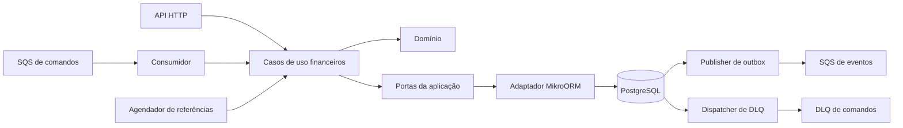
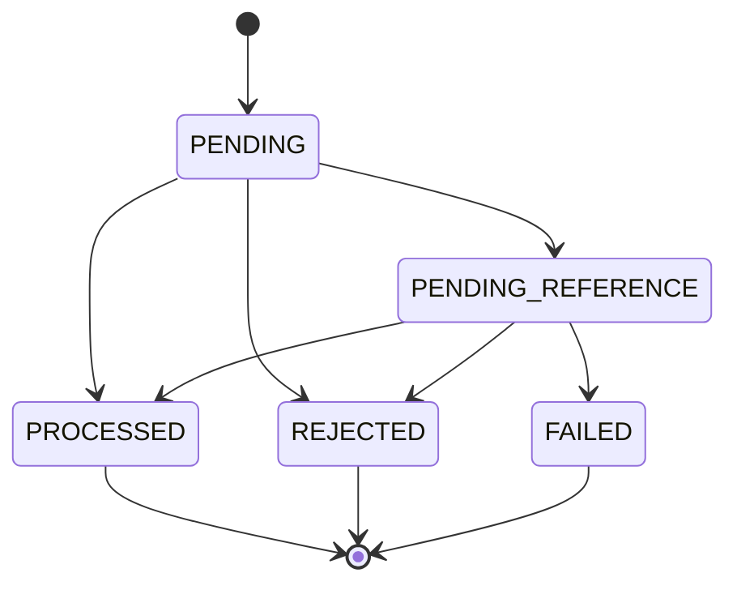

# Arquitetura — Wager Ledger

## Fronteira financeira

Monólito modular com quatro papéis: API HTTP, consumidor SQS/dispatcher de DLQ,
publisher de outbox e agendador de referências. Compartilham domínio, casos de uso
financeiros e PostgreSQL. A wallet é a unidade de concorrência.

**Saldo materializado, ledger, transação, inbox e outbox compartilham o commit.**
Um flush intermediário não confirma uma operação. ACK e envio externo acontecem
somente depois da confirmação pertinente no banco.



## Organização e dependências

```text
src/
  modules/financial/
    domain/              # money, wallet, wagering e validações puras
    application/
      use-cases/         # operações oferecidas pelo módulo
      transactions/      # comando/hash e coordenação compartilhada
      events/            # contratos de integração e construção da outbox
      queries/           # consultas e reconciliação
      ports/             # fronteiras de persistência, transporte e operação
    infrastructure/      # implementações SQL/SQS, cursor, runtime e telemetria
      persistence/migrations/
    presentation/
      http/              # endpoints, identidade, status e erros HTTP
      sqs/               # envelope, handler e lifecycle do consumidor
  platform/              # fábricas técnicas, health e deadline de processo
  bootstrap/             # configuração, registro de modelos/migrations e composição
  main.ts                # entrypoint HTTP
```

Domínio importa somente domínio e Decimal.js. Aplicação depende de domínio e portas.
Apresentação adapta protocolos; infraestrutura implementa portas usando bibliotecas
técnicas. Platform não importa módulos. Bootstrap compõe implementações concretas.
O [guia do módulo](src/modules/financial/README.md) detalha as responsabilidades.

`bun run check:architecture`, integrado ao typecheck, inspeciona a AST do TypeScript:
imports de valor/tipo, resolução local, ciclos, fronteiras e status HTTP no núcleo.
Não é uma prova formal de correção financeira; esta depende também de schema/testes.

## Documentação HTTP interativa

Swagger UI em /docs e OpenAPI 3.0.3 em /docs-json usam @nestjs/swagger 12.0.5,
fixada e compatível com NestJS 12. Metadados, schemas e exemplos pertencem à
apresentação HTTP; bootstrap registra o documento e os endpoints operacionais.
Controllers mantêm os mesmos inputs unknown e a validação existente. A documentação
não adiciona DTOs de validação ou dependências de framework ao domínio/aplicação.

Money é string decimal nos schemas. Abertura e consulta de wallet têm respostas
separadas; resultados de submissão distinguem estado por status HTTP. A UI usa a
mesma origem da API, assets locais e validador externo desativado. Abrir a documentação
não cria dados financeiros; Execute utiliza os endpoints reais. IdP continua adiado.

## Dinheiro, wallet e ledger

Money é imutável, com construtor exclusivo Decimal.js 10.6.0 e precisão de trabalho
40, isolada de configuração global. Entradas/saídas usam strings canônicas com duas
casas. Não há arredondamento ou conversão monetária para number. A faixa acompanha
NUMERIC(20,2); overflow é explícito. O domínio conhece BRL/USD; a aplicação usa BRL.

Entidades usam construtores privados, factories e rehydrate sem reaplicar operações.
A reidratação valida integridade estrutural. Estado encapsulado e cópias defensivas
de datas/snapshots evitam alterações externas.

Wallet é única por player/moeda. Versão começa em 1 e só incrementa quando o saldo
muda. Ledger é append-only, com magnitude positiva e unicidade por wallet/transação
e wallet/versão. A ordem financeira usa versão, não timestamp.

OPENING positiva é interna e atômica com wallet, crédito e dois eventos. Abertura
zero não inventa movimento. BET debita, WIN credita, LOSS zero registra resultado.
REFUND reverte BET; ROLLBACK inverte BET/WIN/REFUND. Referências validam provider,
player, wallet, moeda, rodada, estado, tipo e valor integral das reversões.
REV-D01 permite uma única reversão processada por referência entre REFUND/ROLLBACK;
reverter REFUND não libera a reserva da BET original.

## PostgreSQL e unidade de trabalho

MikroORM 7.2.5 usa modelos separados do domínio, mappers explícitos e DecimalType
em string. Um EntityManager/contexto por unidade, READ COMMITTED e lock pessimista
na linha da wallet. A ordem de aquisição mantém wallet antes das gravações financeiras.
Nenhum mutex de processo ou FIFO substitui o banco. Outras wallets avançam em paralelo.

Flushes controlados preservam cada movimentação intermediária no mesmo commit.
Constraints, FKs, índices, triggers imediatas e validações diferidas incrementais
protegem não-negatividade, imutabilidade, contexto e correspondência saldo/ledger.
As verificações usam wallet/versão/vizinhos indexados, sem somar todo o histórico
por operação. Reconciliação é uma consulta separada, sem reparo automático.

A role app tem DML limitado; migrator é proprietária do schema; admin local prepara
roles e bancos descartáveis. As cinco migrations manuais são reversíveis e têm
nomes/SQL históricos preservados. Não há sincronização automática de schema.

O adaptador usa o helper callback do driver SQL do MikroORM e associa a transação
ao EntityManager. Esse helper propaga falha de rollback e libera conexão. O helper
de alto nível suprime esse erro e não serve para certificar a recuperação descrita abaixo.

## Identidade, resultado e falhas

Idempotency-Key HTTP é obrigatória e globalmente única; identidade externa é única
por provider/ID. SHA-256/JSON-v1 ordena campos de negócio; Money mantém suas strings,
e referência omitida vira null. Key, correlação e metadados de transporte não entram
no hash. Identidade com outra key é conflito. Colisão SQL exige rollback antes de reler.

Replay terminal preserva saldo histórico, estado e failureCode. Domínio/aplicação
não conhecem httpStatus; apresentação mapeia estado para 200/202/422/500. Um decoder
valida o campo legado na leitura sem reescrever terminais. Formato inválido, conflito,
rejeição de negócio e indisponibilidade têm códigos/status distintos.

Reidratação compara a moeda do saldo histórico com o comando nos estados cujo
contexto de wallet já foi validado. Rejeições antecipadas preservam a moeda da wallet:
CURRENCY_MISMATCH exige diferença e WALLET_PLAYER_MISMATCH precede essa validação.
Corrupção detectada bloqueia consulta/replay sem reescrever história.

Desconexão durante COMMIT é indisponibilidade com resultado possivelmente confirmado.
O adaptador reconhece códigos de rede e mensagens exatas do driver quando o rollback
em conexão morta perde o código original; não classifica erros por texto aproximado.
Consulta/reenvio com a mesma identidade recupera o resultado durável em nova unidade.
A prova usa um proxy TCP que observa COMMIT do servidor e retém sua resposta, sem
simular resultado do ORM; inclui execução com inbox e recuperação pelo mesmo pool.

Retry financeiro usa contexto novo, até três tentativas, orçamento de repetição
3 s, lock timeout 250 ms e statement timeout 2 s por default. O orçamento é conferido
antes de repetir; não é promessa de deadline absoluto de rede.



PENDING só existe dentro da unidade SQL. Pendências têm prazo, tentativas e próximo
instante persistidos: defaults 24 h/1.000 verificações, backoff 5–300 s com jitter.
Scheduler descobre até 50 IDs sem lock financeiro e retoma até cinco por vez,
revalidando sob lock. Referência disponível prevalece sobre prazo vencido; expiração
é REJECTED com evento, sem DLQ. Reenvio apenas consulta o resultado durável.

FAILED automático é restrito a INVALID_REFERENCE_STATE. Exige rollback confirmado,
nova unidade/lock, mesma pendência/agendamento, ausência de efeitos e referência ainda
inválida. Referência reparada ou outro terminal prevalecem. Erro genérico, corrupção
da própria wallet/pendência e commit incerto não autorizam FAILED. Diagnóstico e tarefa
DLQ canônica, quando há origem SQS, compartilham o commit dessa recuperação.

## SQS, inbox, DLQ e outbox

Comandos entram em wager-transactions.fifo, com DLQ própria. Inbox persistente por
consumer/messageId usa hash do envelope completo, distinto do hash financeiro.
ACK segue o commit. Origem/corpo de uma pendência são preservados antes de ACK para
permitir encaminhamento tardio; HTTP-only não recebe envelope fictício.

Consumidor usa grupos FIFO por wallet, heartbeat e retry/backoff. Perda de visibilidade
pode gerar dois recebimentos em paralelo: locks, inbox e unicidades preservam o efeito.
Dispatcher usa tarefa durável, lease/token e envio fora do SQL. Confirmação é condicionada
à posse; retry preserva transferId e corpo. Suspensão não descarta responsabilidade.

Quatro eventos concretos de integração alimentam a outbox: Processed, Rejected,
PendingReference e BalanceChanged. Este último só existe quando saldo muda.
Publisher seleciona até dez com SKIP LOCKED, claim de 30 s/renovação de 10 s, envia
fora da unidade financeira e confirma com fencing. Dez falhas suspendem; backoff
1–300 s. Retomada é auditada, sem reescrever eventId/payload.

Envio aceito seguido de crash antes da confirmação admite duplicata. Entrega é
at-least-once. Consumidores precisam deduplicar IDs e lidar com versões atrasadas;
o consumidor/projeção demonstrado existe só nos testes. Não há ordem estrita de
publicação por wallet nem exactly-once entre PostgreSQL e SQS.

## Observabilidade e lifecycle

FinancialTelemetry é uma porta; falha do sink não altera finanças/ACK/publicação.
Cada operação ou entrega tem contexto explícito próprio, enriquecido com IDs validados
conforme disponíveis. Retry, locks, transição e ACK usam essa correlação. Não há contexto
global compartilhado, payload financeiro, chaves ou receipt handles nos logs.

Métricas têm labels limitadas, sem IDs/quantias. Transições contam depois de commit;
replays são separados. Gauges de backlog/lag incluem suspensos. Falha de coleta preserva
última observação e sinaliza erro/idade. Counters reiniciam com o processo; não são ledger.

Live independe de serviços. Ready testa PostgreSQL/schema e filas do papel, em paralelo
com deadline padrão 2 s. Backlog é amostrado a cada 15 s. API/workers têm endpoints
próprios em loopback; gauges SQL repetem o mesmo banco e não devem ser somados.

SIGTERM para admissões e inicia um deadline referenciado de 30 s por default.
Ele cobre trabalho admitido e toda a limpeza, sendo cancelado apenas ao terminar.
Limpeza tenta todos os recursos mesmo após erro anterior; prazo esgotado encerra com
código 1, sem ACK/commit especulativo. Sinais repetidos não prorrogam o limite.

## Execução, testes e limites

Compose executa PostgreSQL 17/LocalStack 4.0.3 fixados por digest; quatro papéis Bun
rodam no host. `bun run setup` prepara configuração/dependências/schema/filas.
Prettier fixado verifica estilo; migrations históricas ficam fora da reformatação.
CI de Ubuntu 24.04 instala pelo lockfile, prepara serviços e executa checks/testes.
Evidência de execução hospedada só existe após publicação e execução do workflow.

Testes usam PostgreSQL/LocalStack reais, bancos/filas UUID, processos separados e
barreiras observadas no banco. As provas e resultados atuais estão no
[mapa de evidências](docs/evidence.md). A validação Linux local não equivale a deploy AWS.

IdP é adiado, com ProviderIdentityPort/guard local sem autenticação. SQS é canal interno
confiável, com provider validado pelo núcleo. Sem controle de identidade, não há garantia
de autorização pública. Câmbio, dashboard, tracing, carga e containers de aplicação
permanecem fora do escopo. Ledger de entrada única atende ao recorte; partidas dobradas
não foram assumidas.

Decisões: [ADRs](docs/adr/README.md). Contratos: [specs](docs/specs/README.md).
Operação: [manual](docs/operations.md). Etapas anteriores: [histórico](docs/history/README.md).
