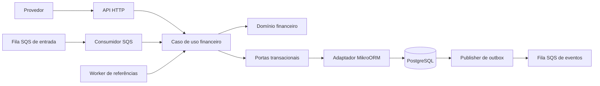
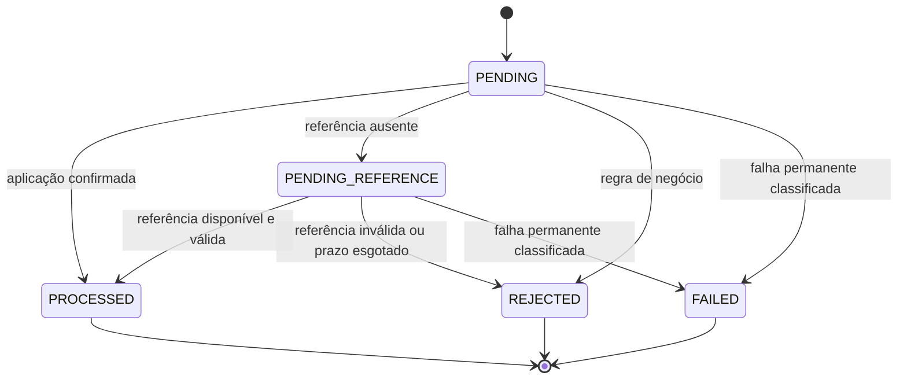

# Arquitetura — Wager Ledger

## Estado e objetivo

Arquitetura aprovada para orientar a implementação em etapas. Atualmente existe somente o bootstrap NestJS com `GET /`, TypeScript estrito e build. Banco, domínio financeiro, workers, autenticação, métricas e testes financeiros ainda não existem.

O escopo funcional e os critérios de aceite estão em [requirements](docs/requirements.md); as justificativas das decisões, em [ADRs](docs/adr/README.md). Os diagramas abaixo descrevem o sistema alvo.

Os contratos e cenários de cada funcionalidade serão detalhados nas [specs](docs/specs/README.md). A [SPEC-001](docs/specs/001-money.md) está aprovada na revisão 1.0 e define formato, moedas, precisão, factories, operações, serialização e erros de Money. A implementação ainda não foi iniciada; aprovação documental não autoriza sua execução automática.

A [SPEC-002](docs/specs/002-wallet-and-ledger.md) está aprovada na revisão 1.0 e define abertura, movimentações, versão, ledger, estratégia de enforcement no banco e contratos de erro. Domínio, schema e proteções SQL permanecem sem implementação; a aprovação não substitui testes reais de integridade e concorrência.

[SPEC-003 a SPEC-008](docs/specs/README.md) estão redigidas como rascunhos de processamento, reversões, SQS, outbox, consultas e observabilidade. Seus defaults recomendados tornam o planejamento concreto e serão revisados ao aplicar as specs; não substituem decisões arquiteturais aceitas por aprovação implícita. A proposta REV-D01 de impedir reversões cumulativas por tipos diferentes é uma restrição adicional de negócio, explicitamente em revisão.

As revisões 0.2 de SPEC-003/004/005 incorporam ajustes da revisão independente: rejeição auditável para overflow do saldo resultante de crédito válido; igualdade de amount somente em reversões, sem restringir WIN/LOSS referenciadas; responsabilidade durável de DLQ que prevalece sobre o ACK genérico de replay. Os ajustes corrigem ambiguidades dos rascunhos, sem promover esses documentos a aprovação integral.

O sistema deve processar operações financeiras corretamente mesmo com entrega duplicada, referências fora de ordem, múltiplas instâncias e falhas antes ou depois do commit. A garantia central é: saldo materializado igual ao saldo reconstruído pelo ledger, sem saldo negativo ou efeitos financeiros duplicados.

## Estilo e limites

Monólito modular, arquitetura hexagonal e modelagem de domínio com classes e invariantes explícitas. A unidade de implantação pode executar papéis separados: API, consumidor SQS, reprocessador de referências e publisher de outbox. Todos compartilham o mesmo núcleo financeiro e PostgreSQL.

Wallets, transações e ledger pertencem ao mesmo módulo financeiro, pois precisam de uma fronteira transacional comum. Separá-los em bancos ou serviços independentes tornaria essa garantia mais complexa sem atender a um requisito adicional.



### Estrutura alvo

```text
src/
  modules/
    financial/
      domain/             # Money, Wallet, WagerTransaction, ledger, eventos e erros
      application/        # casos de uso, portas, resultados e coordenação transacional
      infrastructure/     # modelos ORM, mappers, repositórios e adaptadores
      presentation/       # HTTP e tradução da entrada SQS
  platform/
    database/             # configuração MikroORM e migrations
    messaging/            # cliente SQS, polling, visibilidade e lifecycle
    observability/        # logs, métricas e contexto de correlação
  bootstrap/              # composição e entrypoints de API/workers
tests/
  integration/
  concurrency/
  support/
docs/
  adr/
```

Testes unitários poderão ficar próximos ao domínio (`*.test.ts`). Pastas e arquivos serão criados quando houver comportamento a implementar. O bootstrap atual será movido em uma etapa específica; esta documentação não altera sua localização.

### Direção das dependências

- Domínio: regras financeiras puras; depende apenas de recursos da linguagem e biblioteca decimal aprovada.
- Aplicação: domínio e interfaces de portas para transação, repositórios, relógio e IDs quando necessários. Sem imports de MikroORM ou SDK SQS.
- Infraestrutura: implementa as portas; mapeia persistência para `rehydrate`; mantém os detalhes do EntityManager fora do domínio.
- Apresentação: valida o transporte, constrói comandos e traduz resultados. HTTP e SQS usam o mesmo caso de uso de processamento.
- Bootstrap: faz a injeção das implementações e seleciona os papéis do processo.

Esses limites serão verificados por revisão e, em etapa posterior, por checks automatizados de imports. `AGENTS.md` orienta o trabalho, mas não substitui enforcement por código, constraints e testes.

## Domínio e dinheiro

`Money` contém decimal exato e moeda. Usa Decimal.js com construtor exclusivo configurado para 40 dígitos significativos de trabalho e strings na entrada/saída. A persistência planejada é `NUMERIC(20, 2)`, com moeda separada: até 18 dígitos inteiros e dois decimais, com limite positivo `999999999999999999.99`. Valores são armazenados como decimais monetários, sem conversão para centavos inteiros. O driver e os mappers devem preservar strings/decimais, sem passagem por `number`.

A magnitude de Money acompanha a faixa da persistência; overflow de entrada ou resultado gera erro sem arredondar. A precisão de trabalho cobre resultados intermediários de soma/subtração de dois operandos válidos, mas não define capacidade ilimitada de agregação. A reconciliação detalhará sua estratégia de acumulação em spec própria. A versão de Decimal.js será fixada na implementação; a biblioteca ainda não está instalada. A decisão está registrada no ADR 0001.

Entradas monetárias exigem strings com exatamente duas casas; `"25"`, `"25.0"` e valores numéricos são rejeitados, sem normalização silenciosa. Entradas também rejeitam valores negativos, strings vazias, notação científica, `NaN` e `Infinity`. As operações aritméticas do núcleo financeiro são soma, subtração e inversão; não exigem arredondamento. O domínio permanece multimoeda, usando BRL e USD nos testes de conflito. A aplicação aceita somente BRL na primeira versão; essa restrição não pertence ao objeto Money.

O escopo da primeira versão inclui BRL nas entradas, saldos, transações, ledger e apresentação de valores. Não haverá seletor de moeda, equivalente cambial, cotação externa ou conversão entre carteiras. O suporte multimoeda do domínio preserva a possibilidade de evolução sem introduzir fluxo de câmbio. Câmbio exigirá nova definição de escopo, spec e aprovação antes de qualquer integração.

O catálogo de Money contém BRL e USD, localmente versionado no Git e sem dependência externa. Códigos precisam coincidir exatamente com a lista, em maiúsculas. Amount usa forma decimal canônica, sem espaços, sinal positivo, zeros excedentes à esquerda ou formato regional. Operações binárias, inclusive equals, geram erro para moedas diferentes. rehydrate valida integridade da representação e admite negativos internos, mantendo a restrição de saldo não negativo na Wallet. Contratos de erros e serialização estão fixados na SPEC-001.

Agregados e entidades encapsulam seu estado com factories `create`/`open` e `rehydrate`. A reidratação não reaplica transições de negócio. O ORM tem modelos separados e mappers explícitos.

Wallet e ledger usam IDs internos UUID gerados pelo backend, playerId UUID válido e timestamps UTC. Identidade e createdAt são imutáveis. Falhas de domínio não deixam mutação parcial de saldo, versão ou updatedAt. A SPEC-002 distingue INVALID_MOVEMENT_AMOUNT, INSUFFICIENT_FUNDS, INVALID_LEDGER_ENTRY, INVALID_PERSISTED_WALLET e INVALID_PERSISTED_LEDGER_ENTRY, preservando os códigos já aprovados de Money. O caso de uso de reversão deverá distinguir sua rejeição por saldo insuficiente da rejeição de BET.

| Operação | Efeito | Referência |
|---|---|---|
| `OPENING` | Crédito inicial, quando saldo inicial > 0 | Interna; proibida em HTTP/SQS |
| `BET` | Débito, sujeito a saldo disponível | Não obrigatória |
| `WIN` | Crédito | BET da mesma rodada quando informada |
| `LOSS` | Sem movimentação | Validar contexto quando informada |
| `REFUND` | Crédito do valor integral | BET processada |
| `ROLLBACK` | Efeito inverso da referência | BET, WIN ou REFUND processada |

As políticas adicionais de referência para WIN/LOSS e valores zero estão listadas como decisões pendentes. Não ampliar nem restringir contratos por conveniência de implementação.

A OPENING tem origem INTERNAL definida pelo backend, identidade estável vinculada à wallet e nenhum provider, game ou round externo fictício. Há no máximo uma OPENING por wallet. Abertura positiva confirma wallet, transação processada, crédito de ledger e eventos WagerTransactionProcessed/WalletBalanceChanged na mesma transação SQL; o evento de saldo informa walletVersion 1. Abertura zero não cria OPENING, ledger ou esses eventos. Entrada externa não pode assumir origem interna. A publicação dos eventos ocorre depois do commit via outbox.

As reversões precisam conferir provider, player, wallet, moeda, rodada, tipo permitido, estado processado e valor integral. Um índice único por referência e tipo de reversão evita duplicação concorrente. O requisito proíbe repetir a reversão pelo mesmo tipo; qualquer restrição adicional entre REFUND e ROLLBACK deve ser decidida explicitamente.

### Estados



Enquanto uma referência não estiver disponível, o registro permanece `PENDING_REFERENCE`; novos agendamentos não reabrem estados terminais. Erro transitório não vira `FAILED`: deve causar rollback e retry. Falhas permanentes que possam ser auditadas exigem persistência segura após rollback, rechecando idempotência e estado sob a mesma disciplina de locks. Não marcar `FAILED` se outro processamento já confirmou um resultado terminal.

## Persistência e garantias no banco

PostgreSQL é a autoridade para invariantes compartilhadas entre processos. Abaixo estão obrigações do schema; o DDL final ainda será implementado e testado.

| Registro | Garantias previstas |
|---|---|
| Wallet | PK; unique `(player_id, currency)`; saldo `>= 0`; versão `>= 1` |
| Transação | PK; idempotency key única; unique `(provider_id, external_transaction_id)`; tipo/estado válidos; referência com FK quando resolvida |
| Reversão processada | Unicidade da referência por tipo, aplicável às reversões efetivadas |
| Ledger | Unique `(wallet_id, transaction_id)` e `(wallet_id, wallet_version)`; FKs; mesma moeda; aritmética e saldos válidos; bloqueio de UPDATE/DELETE |
| Inbox | Unique `(consumer_name, message_id)`; hash persistido; confirmação na transação financeira |
| Outbox | Event ID estável; envelope versionado; estado de publicação, tentativas e claim/lease persistidos |

Constraints, FKs compostas, triggers e privilégios serão combinados para garantir moeda, imutabilidade e associação entre transação e wallet. A estratégia aprovada usa constraints para regras locais e constraint triggers diferidas para relações entre registros financeiros no commit. Deve impedir mudanças de saldo sem ledger, ledger sem mudança válida e alterações de contexto ou estado terminal que invalidem o histórico. As verificações são incrementais por wallet/versão e vizinhos indexados, sem somar todo o histórico a cada operação, cobrindo também múltiplas mudanças na mesma unidade SQL.

As migrations e funções SQL implementarão essa estratégia; testes deverão tentar violar cada garantia usando o papel de banco da aplicação. DDL e evidências de concorrência ainda não existem. Se a implementação exigir mudança da estratégia ou do contrato, a revisão será explícita. Não declarar esses pontos atendidos só porque a aplicação evita a operação.

O ledger será append-only e de entrada única, conforme o mínimo exigido. Partidas dobradas ficam fora da primeira versão. A reconciliação usa uma leitura consistente do saldo e do ledger na mesma fotografia transacional; não compara consultas feitas em instantes diferentes. Divergência gera resposta, log e métrica, sem correção silenciosa.

Débitos, créditos e criação de lançamentos exigem money estritamente positivo. Zero continua válido como saldo e saldo inicial, mas não cria movimentação, ledger ou incremento de versão. A aceitação de requisições de valor zero por tipo será detalhada na SPEC-003; uma operação sem efeito financeiro não chama debit/credit.

Cada lançamento registra walletVersion. O crédito de abertura positiva corresponde à versão 1; após abertura zero, a primeira movimentação corresponde à versão 2. A ordenação financeira usa essa sequência por wallet, sem depender de horários distintos. A garantia de continuidade e ligação entre before/after e saldo final será imposta pela estratégia de banco aprovada na SPEC-002 e comprovada na implementação.

## Transação financeira e concorrência

Escolha inicial: `READ COMMITTED` com lock pessimista de linha da wallet (`SELECT ... FOR UPDATE` ou equivalente MikroORM), constraints e retry limitado para falhas transitórias. A wallet é a unidade de concorrência. Outra wallet pode avançar em paralelo.

Ordem comum dos caminhos financeiros: wallet → registros de idempotência/transação → referência/ledger/inbox/outbox. Todos os caminhos, inclusive abertura, HTTP, SQS e reprocessamento, precisam obedecer a uma ordem compatível. Workers não podem segurar um lock de transação candidata e depois tentar adquirir a wallet na ordem inversa.

Fluxo de processamento alvo:

1. Validar contrato e identidade/contexto do provedor; calcular hash canônico dos campos de negócio.
2. Abrir unidade de trabalho com contexto MikroORM exclusivo.
3. Localizar e bloquear a wallet, conferindo contexto e moeda.
4. Resolver/registrar a identidade da operação por inserção protegida pelas duas unicidades. Conflito de unique deve ser tratado com operação SQL que mantenha a transação utilizável, ou rollback e nova transação; não continuar após erro SQL que abortou a transação.
5. Conferir chave, identidade externa e hash. Replay devolve o resultado original. Identidades divergentes geram conflito e nunca movimentação.
6. Para SQS, validar e registrar a inbox na mesma unidade de trabalho. Um `messageId` já visto com payload divergente é erro permanente de transporte, não replay válido.
7. Revalidar estado e referência; aplicar regras no domínio. Ausência de referência gera pendência durável; rejeição de negócio permanece auditável.
8. Persistir transação, eventual saldo/versão, eventual ledger, inbox e eventos de outbox. Guardar resultado com saldo observado para replay terminal.
9. Commit. Somente depois responder com sucesso definitivo ou fazer ACK da mensagem.

O caso de uso de aplicação solicita a transação por uma porta; o adaptador usa o EntityManager transacional. Cada repositório da operação recebe o mesmo contexto. Não há chamadas de rede dentro da transação financeira.

Corridas entre identidades externas e chaves diferentes devem falhar antes de qualquer efeito financeiro. Mesmo com wallet IDs divergentes no payload, as constraints de identidade continuam globais e o conteúdo é comparado. Tentativas de unique ou lock com erro exigem rollback/recuperação explícita; não tratar exceções genéricas como saldo insuficiente.

### Cenário de aceitação de concorrência

Wallet com `100.00 BRL`; duas apostas simultâneas de `80.00 BRL`. O primeiro processo bloqueia a wallet, debita e confirma. O segundo adquire o lock depois, vê `20.00 BRL` e rejeita por saldo insuficiente. Resultado: um débito no ledger e saldo `20.00 BRL`. Redelivery não repete o débito.

O lock de linha serializa a carteira com muita disputa; isso limita throughput dessa carteira. A escolha favorece previsibilidade e clareza. Otimização exige medição e preservação das mesmas invariantes.

## Idempotência e contratos

A idempotency key é globalmente única nesta solução. HTTP usa obrigatoriamente o header; SQS usa o campo correspondente no envelope. A identidade externa é única por provider. Reenvio com outra key para a mesma identidade externa será conflito de identidade, decisão a detalhar no contrato antes da implementação.

Hash alvo: SHA-256 do JSON canônico com chaves ordenadas recursivamente, contendo somente os campos de negócio aprovados. Strings monetárias validadas são serializadas na representação canônica de duas casas; não entram header, `messageId`, correlação ou timestamp de transporte. A lista exata de campos, tratamento de opcionais e vetores de teste serão fixados antes da implementação para evitar hashes dependentes da ordem das chaves ou metadados.

O resultado terminal original inclui transaction ID, estado, saldo observado e código de falha quando houver. Replay conserva esses dados e indica `idempotentReplay: true`. Uma pendência pode evoluir até um estado terminal: antes disso, o replay informa o estado durável corrente, sem repetir efeitos. Após terminal, o resultado é estável.

Mapeamento HTTP planejado:

| Situação | Status |
|---|---|
| Wallet criada | `201` |
| Operação processada, replay processado e consultas | `200` |
| Contrato/header inválido | `400` |
| Recurso inexistente | `404` |
| Wallet duplicada ou conflito de idempotência/identidade | `409` |
| Rejeição financeira de negócio, inclusive replay rejeitado | `422` |
| Aceita aguardando referência | `202` |
| Infraestrutura temporariamente indisponível | `503` |
| Erro inesperado ou falha permanente interna | `500`, com código estável e sem detalhes sensíveis |

Consultas de transações rejeitadas retornam `200` com o recurso e seu estado. O status `422` se aplica à submissão. A taxonomia completa de falhas e envelopes HTTP precisa ser aprovada na etapa dos contratos.

## SQS, inbox e referências fora de ordem

Entrada: `wager-transactions.fifo`; DLQ: `wager-transactions-dlq.fifo`. LocalStack será usado no Docker Compose e nos testes. `MessageGroupId = walletId` é otimização de ordenação. As garantias continuam no PostgreSQL, inclusive para entrada HTTP concorrente.

O consumidor usa polling, valida envelope e aciona o mesmo caso de uso HTTP com contexto de inbox. Rejeição de negócio é terminal e recebe ACK após commit. Pendência recebe ACK depois de persistida: a continuação fica sob responsabilidade do worker de referências.

Falha transitória preserva a mensagem para retry com backoff. Mensagem inválida/permanente segue para DLQ conforme política explícita; a mensagem original só é removida após transferência confirmada quando houver envio manual. Redrive nativo exige contagem e visibilidade compatíveis com o limite aprovado. Falha ao gravar auditoria nunca autoriza ACK de um efeito não confirmado.

No shutdown, o consumidor para novas leituras, aguarda operações em andamento por prazo limitado e devolve visibilidade das que não concluiu. O timeout de visibilidade precisa cobrir processamento ou ser renovado. Redelivery após commit/antes de ACK encontra a inbox e não duplica efeitos.

O worker de referências consulta IDs elegíveis sem manter locks em ordem inversa, adquire a wallet, relê e confere estado e prazo antes de processar. Tentativas, próximo horário e limite são persistentes. Backoff exponencial com jitter e limite/TTL serão definidos antes da implementação. Referência existente mas terminalmente inválida não fica esperando para sempre; a rejeição é específica. Ao esgotar o prazo da referência ausente, registrar rejeição e evento na mesma transação.

## Outbox e eventos

Eventos mínimos: `WagerTransactionProcessed`, `WagerTransactionRejected`, `WalletBalanceChanged` e `WagerTransactionPendingReference`. `IntegrationEvent` é abstrata, com uma classe concreta por evento. O envelope contém event ID, aggregate ID, correlation/causation IDs, data, tipo e versão. Dinheiro no payload é `MoneyProps`, nunca objeto ORM nem instância `Money`.

A fila de saída será separada da entrada; nome proposto `wager-events.fifo`, com DLQ correspondente. Não criar loop devolvendo eventos à fila de comandos.

Publisher concorrente:

1. Transação curta seleciona lote vencido usando `FOR UPDATE SKIP LOCKED` e registra claim com token e lease; commit libera locks.
2. Publicação externa ocorre fora da transação SQL, reutilizando o event ID estável.
3. Confirmação de publicação atualiza a outbox apenas se o claim/token ainda pertencer ao publisher.
4. Em falha, persistir tentativas e próximo horário; claims abandonados expiram e podem ser retomados.

Se o envio ocorrer e o processo morrer antes de marcar publicado, pode haver duplicata. Consumidores precisam deduplicar por event ID persistente. Lease não elimina essa janela. Retries não podem descartar silenciosamente eventos: após o limite operacional, manter registro recuperável e emitir diagnóstico para intervenção/reprocessamento. Publicação só ocorre para outbox visível após commit financeiro.

## Autenticação e observabilidade

A integração com IdP externo está adiada para priorizar a consistência do núcleo financeiro nesta fase. A aplicação futura terá `ProviderIdentityPort` explícita e adaptação OIDC planejada. Sem autenticação, não existe garantia de identidade do chamador HTTP; validar provider no payload é validação de domínio, não autenticação. Health fica aberto; SQS é canal interno confiável, mas campos do provedor continuam validados. A exposição pública em produção depende da implementação e validação dos controles de identidade e acesso.

Logs JSON usarão correlation ID, message ID, transaction ID, wallet ID e provider ID quando disponíveis. Nunca registrar payload completo, tokens ou credenciais. Métricas: transações por estado, duplicatas, retries, DLQ, conflitos/espera de locks, outbox lag e latência. IDs individuais não são labels de métricas para evitar cardinalidade sem limite.

Health planejado: `/health/live` verifica processo; `/health/ready` verifica PostgreSQL e SQS. Ambos são públicos. O atual `GET /` não atende esses requisitos. OpenTelemetry e dashboard ficam como opcionais após garantias obrigatórias.

## Estratégia de comprovação

- Unidade: Money, factories, invariantes, transições, moedas e regras dos cinco tipos externos; Bun test.
- Integração: PostgreSQL e LocalStack reais; migrations up/down, constraints, atomicidade, inbox, retries, DLQ e recuperação.
- Concorrência: pelo menos três processos independentes, pools e contextos separados; barreiras de sincronização para provocar disputas reais.
- Falhas: interrupções controladas depois do commit/antes de ACK e depois do envio/antes da confirmação da outbox; comprovar retomada.
- Todos os cenários financeiros conferem saldo pelo ledger e ausência de efeitos duplicados. Sleeps isolados não demonstram uma disputa concorrente.
- Testes de arquitetura/imports serão adicionados em etapa específica; documentação não conta como evidência de enforcement.

O roteiro de demonstração e as evidências esperadas estão em [demo](docs/demo.md). Cada requisito só será marcado como atendido após apontar implementação e teste executado.

## Etapas e decisões ainda abertas

Cada etapa abaixo depende de aprovação própria:

1. Documentação da arquitetura e regras de trabalho (esta entrega).
2. Domínio puro e políticas ainda abertas, com testes unitários.
3. Schema, migrations, PostgreSQL, MikroORM e garantias no banco.
4. Casos de uso transacionais, idempotência e API HTTP.
5. SQS, inbox, reprocessamento e outbox com recuperação.
6. Observabilidade, cenários multiprocesso, evidências e validação operacional.

Na etapa de implementação, revisar os defaults já detalhados nas specs 003–008: política de zero e referências por tipo, interação REFUND/ROLLBACK, taxonomia de falhas, hash, envelope de erros, providers, TTL/backoff/limites, cursor e leases. A versão de Decimal.js e das demais dependências será fixada no setup autorizado. A estratégia de garantia cruzada saldo-ledger está aprovada; SQL e testes são entregas da implementação. SPEC-001 e SPEC-002 não possuem decisões funcionais pendentes nos respectivos escopos. O índice de specs separa defaults operacionais de funcionalidades opcionais.

Essas pendências não autorizam decisões implícitas. Registrar cada definição e suas consequências no ADR relacionado. As limitações atuais são intencionais e visíveis: existe bootstrap, mas nenhuma garantia financeira ou de mensageria foi implementada ou comprovada ainda.
