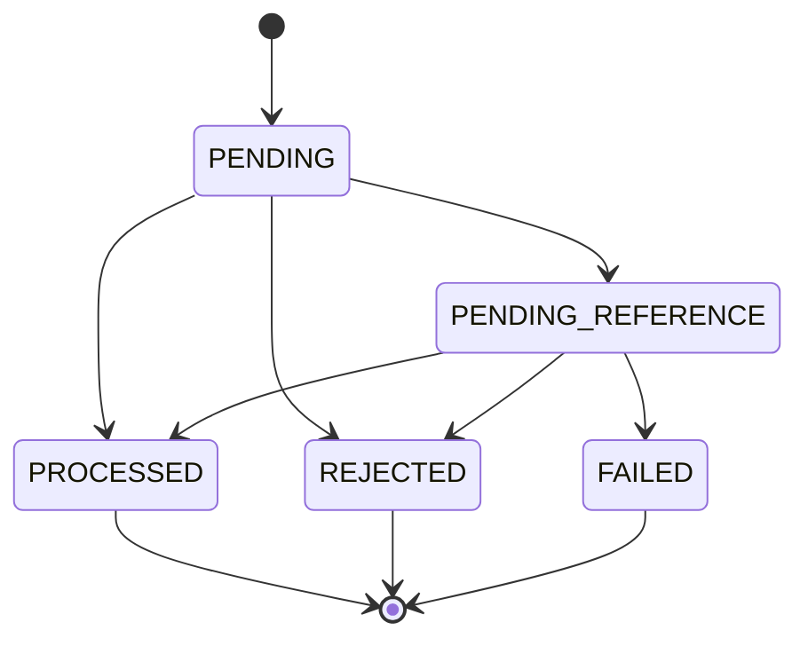

# SPEC-003 — Processamento de transações e idempotência

| Campo | Conteúdo |
|---|---|
| ID | SPEC-003 |
| Estado | Verificada no recorte — processamento, transportes e recuperação restrita de FAILED |
| Revisão | 0.7 |
| Requisitos relacionados | F04, F09, D04, D05, D08, D09, D12, D15, A01–A07, A10, A11, M02, M04, M10, M11, O03, O04 |
| Dependências | SPEC-001 e SPEC-002 aprovadas; coordenação com SPEC-004, SPEC-005 e SPEC-006 |
| Aprovação do conteúdo | Etapa de abertura/processamento autorizada em 27/10/2026; PROC-D01/D02/D03 e limites de comando adotados no recorte de aplicação; HTTP/SQS verificados; recuperação restrita autorizada e verificada em 27/10/2026 |
| Implementação | WagerTransaction, ProcessTransaction, hash/replay/conflitos e eventos/outbox; evidências abaixo |

## Objetivo e escopo

Processar operações externas com resultado persistente e reproduzível, sem duplicar efeitos financeiros. HTTP e SQS compartilham o mesmo caso de uso e as garantias no PostgreSQL.

Esta spec define admissão, identidade, hash, resultado, estados, BET/WIN/LOSS e fronteira transacional. [Reversões](004-reversals-and-pending-references.md), [inbox](005-sqs-and-inbox.md) e [publicação](006-outbox-and-events.md) têm specs próprias, mas não podem ser omitidas da atomicidade do fluxo completo.

Não inclui câmbio, cobrança externa, cadastro de jogadores, encerramento agregado de rodada ou autenticação artesanal. Não impor uma única WIN por rodada nem exclusividade WIN/LOSS sem novo requisito: a identidade financeira é a transação.

## Regras de base

- Preservar os contratos aprovados de [Money](001-money.md) e [Wallet/ledger](002-wallet-and-ledger.md).
- Transações externas têm origem PROVIDER; OPENING/INTERNAL só podem ser criadas pelo caso de uso de abertura.
- Unicidades persistentes: idempotency key global e `(providerId, externalTransactionId)` para origem externa. O namespace interno de OPENING é separado e inacessível ao cliente.
- Mesma identidade e payload válido retornam o resultado original. Chave ou identidade incompatível gera conflito, nunca atualização do payload original.
- Estados terminais, identidade, payload e resultado terminal não podem ser reescritos. Constraints e proteções de schema reforçam essa regra.
- Cada mudança de saldo gera exatamente um ledger e um WalletBalanceChanged; LOSS e rejeições não movimentam saldo, versão ou updatedAt da wallet.

## Contrato HTTP recomendado

```http
POST /wagering/transactions
Idempotency-Key: provider-a:transaction-123
Content-Type: application/json
```

```json
{
  "providerId": "provider-a",
  "externalTransactionId": "transaction-123",
  "playerId": "0192f28f-5dc0-7d58-bdb2-814ad6a0f4a1",
  "walletId": "0192f291-27dd-7d3f-8071-5f8685deef37",
  "roundId": "round-987",
  "gameId": "game-001",
  "kind": "BET",
  "money": { "amount": "25.00", "currency": "BRL" }
}
```

Tipos externos: BET, WIN, LOSS, REFUND e ROLLBACK. `referenceExternalTransactionId` é opcional no contrato geral e obrigatório para REFUND/ROLLBACK. Ausência é diferente de string vazia; null não é uma referência válida. IDs de player/wallet são UUIDs. Money é validado sem normalização silenciosa.

Defaults de limites: providerId até 64 caracteres; externalTransactionId, roundId, gameId e referência até 128; header de idempotência até 255; strings não vazias e sem espaços externos. Rejeitar campos desconhecidos, inclusive tentativas de fornecer origem, estado, saldo ou versão. Não inferir uma key quando o header faltar. Esses limites estão implementados no validador compartilhado de comando, integrado aos transportes HTTP e SQS.

ProviderId deve satisfazer formato e admissão na lista configurada de provedores, sem serviço remoto de consulta. Fixtures locais incluem provider-a e provider-b. A lista não autentica o chamador. Admitir somente BRL na primeira versão; outras moedas representáveis continuam válidas apenas no domínio/testes.

## Identidade, hash e replay

**Default PROC-D01:** calcular SHA-256, em UTF-8, do JSON com chaves ordenadas recursivamente, sem espaços de formatação. Incluir exatamente providerId, externalTransactionId, playerId, walletId, roundId, gameId, kind, money.amount, money.currency e referenceExternalTransactionId. No objeto canônico, referência omitida ocupa null. Chaves de money ficam na ordem amount/currency. Arrays não fazem parte desse contrato.

Não incluir header de idempotência, correlationId, messageId, occurredAt de transporte ou metadados SQS. Não converter valores para números, normalizar Unicode ou alterar identificadores. Money já chega na forma canônica aprovada. Registrar algoritmo/versão do hash para estabilidade futura.

| Situação | Resultado recomendado |
|---|---|
| Key e identidade novas | Criar e processar uma única operação |
| Mesma key, mesma identidade e mesmo hash | Replay do resultado durável |
| Mesma key com payload diferente | 409 IDEMPOTENCY_CONFLICT |
| Mesma identidade externa com key diferente | 409 EXTERNAL_TRANSACTION_CONFLICT, mesmo se o hash coincidir |
| Key aponta uma transação e identidade externa aponta outra | 409; nenhuma das duas é alterada |
| Provedor diferente reutiliza a mesma key global | 409; o padrão recomendado inclui provider na key |

O header é a fonte da key HTTP; no SQS, o campo equivalente é obrigatório. O hash é calculado do comando de negócio equivalente nos dois transportes.

Persistir o resultado terminal com transactionId, status, failureCode quando houver e balance observado. A apresentação determina o status HTTP pela tabela estável do estado financeiro; o domínio/aplicação não armazenam código de transporte nos resultados novos. Replay muda apenas idempotentReplay e metadados de transporte da resposta, nunca o saldo histórico. Se outras operações mudarem a wallet, não recalcular a resposta antiga pelo saldo atual.

A reidratação exige que a moeda do saldo histórico corresponda à do comando em
PROCESSED, PENDING_REFERENCE, FAILED e rejeições após validação do contexto da wallet.
CURRENCY_MISMATCH exige moedas distintas; WALLET_PLAYER_MISMATCH ocorre antes de
validar moeda e conserva o saldo da wallet consultada. Essas rejeições antecipadas
não autorizam inferir a moeda da wallet a partir do comando incompatível. Corrupção
detectada retorna erro de integridade, sem reparar o snapshot ou reaplicar efeitos.

Em READ COMMITTED, outra unidade pode confirmar entre a leitura por key e a
leitura por identidade externa. Encontrar o vencedor por qualquer consulta exige
comparar key/hash: mesma key e hash é replay; mesma key com hash diferente é
IDEMPOTENCY_CONFLICT; identidade externa com outra key é EXTERNAL_TRANSACTION_CONFLICT.
A existência da identidade externa, isoladamente, não comprova conflito.

Antes de terminal, uma pendência pode evoluir. Um reenvio de PENDING_REFERENCE consulta o estado durável corrente sem disparar novo efeito; o worker da SPEC-004 continua responsável pela execução. Consultas retornam o recurso atual conforme SPEC-007.

## Regras por operação recomendadas — PROC-D02

| Tipo | Valor recomendado | Referência | Efeito |
|---|---|---|---|
| BET | Estritamente positivo | Não aceitar referência | Débito sujeito a saldo |
| WIN | Estritamente positivo | Opcional; quando fornecida, BET processada do mesmo contexto | Crédito |
| LOSS | Exatamente zero | Opcional; quando fornecida, BET processada do mesmo contexto | Resultado registrado, sem ledger |
| REFUND / ROLLBACK | Estritamente positivo | Obrigatória | Política da SPEC-004 |

Money válido com valor inadequado ao kind gera rejeição auditável INVALID_OPERATION_AMOUNT após reservar a identidade financeira; não chega a debit/credit. Isso distingue formato inválido de regra de negócio. Referência indevida em BET ou obrigatória ausente em reversão é erro de contrato 400.

Quando WIN/LOSS informarem referência, aplicar validações de provider, player, wallet, moeda, rodada, tipo e estado; não exigir gameId idêntico além dessas regras. Referência inexistente ou ainda não processada fica PENDING_REFERENCE conforme SPEC-004. Sem referência informada, WIN/LOSS não precisam esperar uma BET por inferência de roundId.

WIN/LOSS não herdam a igualdade de amount das reversões: WIN pode diferir do valor da BET referenciada e LOSS segue sua regra própria de zero. A igualdade integral pertence somente a REFUND/ROLLBACK.

**Default aplicado na etapa autorizada em 27/10/2026:** exigir zero em LOSS e positividade em WIN/BET. A política não altera a capacidade de Money representar zero. Se o contrato do provedor precisar de WIN zero ou valor informativo em LOSS, revisar essa tabela e os testes.

## Estados e falhas

PENDING é o estado de criação dentro da unidade SQL. O fluxo síncrono não confirma apenas um registro PENDING e adia secretamente o débito: confirma resultado terminal ou PENDING_REFERENCE junto aos demais registros pertinentes.



PENDING_REFERENCE permanece nesse estado durante espera/reagendamento, sem produzir um evento repetido a cada tentativa. PROCESSED, REJECTED e FAILED são imutáveis. processedAt é preenchido ao aplicar uma operação; registrar também instante de conclusão para estados terminais sem confundir rejeição com processamento financeiro.

| Código recomendado | Tratamento |
|---|---|
| INVALID_TRANSACTION_INPUT, INVALID_IDEMPOTENCY_KEY | 400, antes de aceitar identidade; preservar códigos de Money aplicáveis |
| UNKNOWN_PROVIDER, UNSUPPORTED_TRANSACTION_CURRENCY | 400, sem registro financeiro com contexto inválido |
| WALLET_NOT_FOUND | 404; não inventar wallet para auditar o pedido |
| IDEMPOTENCY_CONFLICT, EXTERNAL_TRANSACTION_CONFLICT | 409, sem modificar a operação original |
| WALLET_PLAYER_MISMATCH, CURRENCY_MISMATCH, INVALID_OPERATION_AMOUNT | REJECTED / 422 quando o comando tem identidade/contexto suficientes para auditoria |
| INSUFFICIENT_FUNDS | REJECTED / 422 para BET, conforme contrato de Wallet |
| MONEY_OUT_OF_RANGE na entrada | 400 antes de aceitar a identidade, se o próprio amount exceder a faixa de Money |
| MONEY_OUT_OF_RANGE no saldo resultante de crédito válido | REJECTED / 422, com resultado auditável, evento e replay estável; não é falha interna ou transitória |
| REFERENCE_* e REVERSAL_* | Códigos da SPEC-004 |
| INFRASTRUCTURE_UNAVAILABLE | 503 sem presumir rollback; consultar/repetir com a mesma identidade para recuperar eventual commit confirmado |
| PERMANENT_PROCESSING_FAILURE | FAILED auditável apenas com contexto válido e ausência comprovada de efeito confirmado |
| INTERNAL_ERROR / códigos de corrupção persistida | 500, diagnóstico seguro; não converter automaticamente em rejeição ou FAILED financeiro |

Se o amount recebido for válido, mas WIN ou uma reversão de crédito produzir saldo acima de MAX, preservar MONEY_OUT_OF_RANGE como failureCode da rejeição. O domínio não altera saldo, versão ou updatedAt; confirmar a transação REJECTED, o snapshot do saldo anterior, o evento WagerTransactionRejected e a inbox quando aplicável, sem ledger nem WalletBalanceChanged. No SQS, tratar como rejeição de negócio com ACK após commit, não como caso de DLQ.

Replay conserva a rejeição mesmo se outra operação liberar espaço no saldo depois. Uma nova tentativa de negócio exige nova identidade; reversão rejeitada por overflow não consome a reserva de reversão efetivada. Não confundir esse resultado calculado com um amount originalmente inválido, que recebe 400 antes da admissão.

Persistir FAILED em transação de recuperação só é permitido depois de desfazer a tentativa, reler estado sob os mesmos locks e garantir que nenhum commit financeiro foi confirmado. Commit de resultado desconhecido exige consulta/replay pela identidade, nunca marcar FAILED por suposição. Se o banco não permite gravar auditoria com integridade, registrar falha operacional sem afirmar uma transação financeira terminal inexistente.

Se FAILED encerrar uma PENDING_REFERENCE cuja origem SQS já recebeu ACK, a transação de recuperação deve confirmar também a responsabilidade durável de transferência tardia à DLQ definida na SPEC-005. O agendador não depende de nova entrega do comando. Para operação recebida somente por HTTP, persistir diagnóstico operacional recuperável e correlacionado, sem fabricar uma mensagem SQS; uma entrega SQS posterior segue o tratamento normal de replay de FAILED.

Envelope recomendado para erros sem recurso aceito: `{ "error": { "code": "...", "message": "...", "correlationId": "..." } }`. Quando existe transação durável, devolver transactionId, status, failureCode, balance, idempotentReplay e correlationId. Resposta de sucesso usa os mesmos campos aplicáveis, omitindo failureCode ausente. Não expor stack, SQL, tokens ou payload financeiro completo em logs.

O envelope de erro admite `error.details` apenas para campos definidos por código. WALLET_ALREADY_EXISTS exige `details.walletId`, conforme SPEC-002, para recuperar uma criação cuja resposta se perdeu. Os demais códigos não recebem detalhes técnicos automaticamente; nunca serializar a exceção original nesse campo.

201 permanece reservado à abertura de wallet; submissão processada/replay processado usa 200; rejeição/replay rejeitado usa 422; pendência usa 202; FAILED na submissão usa 500. Consulta de qualquer recurso existente usa 200 e seu estado. Header de correlação é opcional; aceitar UUID válido ou gerar novo UUID, sem usar valor arbitrário como log injetável.

## Unidade de trabalho e concorrência

1. Validar contrato e formar comando canônico. Uma consulta inicial sem lock pode reconhecer identidade já existente e conflitos evidentes; não autoriza efeitos financeiros.
2. Abrir contexto MikroORM exclusivo, localizar e bloquear a wallet. Revalidar identidade/hash/estado dentro da unidade de trabalho.
3. Reservar key e identidade externa protegidas por unicidades. Usar inserção que não deixe a transação abortada, ou rollback e nova transação antes de continuar.
4. Repetir verificações de contexto sob lock. Conflito nunca chega ao domínio de movimentação. Para SQS, registrar/verificar inbox no mesmo contexto.
5. Criar transação PENDING, aplicar regras de negócio e, se permitido, Wallet e ledger. Persistir resposta terminal ou pendência e eventos de outbox atômicos.
6. Confirmar, incluindo triggers diferidas. Somente então responder ou autorizar ACK.

Verificar key/hash já existentes antes de mascarar um conflito com um novo walletId inexistente. Consultas rápidas de identidade não adquirem locks financeiros em ordem inversa. Mesmo uma corrida que usa wallet IDs distintos é contida pelas unicidades globais; o perdedor relê a identidade e retorna conflito, sem efeitos.

**Default PROC-D03:** até três tentativas completas para deadlock/serialização/timeout de lock classificados, com jitter entre tentativas e orçamento total de três segundos. Lock timeout inicial de 250 ms e statement timeout de dois segundos, configuráveis. Excedido o orçamento, 503; erro de domínio/identidade não recebe retry técnico. Cada tentativa usa novo contexto e objetos reconstruídos; descartar entidades de uma unidade revertida.

Falha de conexão durante COMMIT pode ocultar uma confirmação durável. Classificar
os erros conhecidos do driver como indisponibilidade, sem afirmar rollback nem
criar FAILED. A política de retry interno acima cobre erros SQL transitórios;
desconexão retorna indisponibilidade e a recuperação consulta/reenvia a mesma
identidade em nova unidade. O resultado confirmado prevalece, inclusive com inbox.

Reenvio de resultado terminal não reavalia saldo nem regras comerciais novas. Alteração da lista de provedores deve distinguir nova admissão de replay durável; não reabrir resultado antigo para aplicar nova configuração. Futuro guard de autenticação continua sendo responsabilidade separada.

## Cenários de aceite

U = unidade; I = PostgreSQL real; C = processos independentes; E = contrato HTTP/SQS.

| ID | Ação / condição | Resultado esperado | Nível |
|---|---|---|---|
| PROC-001 | BET 25.00 em saldo 100.00 | PROCESSED, saldo 75.00, um débito e versão incrementada | U/I/E |
| PROC-002 | WIN 10.00 sem referência | Crédito único; transação processada e eventos corretos | U/I |
| PROC-003 | LOSS 0.00 | PROCESSED, sem ledger, saldo/versão/updatedAt preservados | U/I |
| PROC-004 | BET/WIN zero ou LOSS positivo | Rejeição auditável INVALID_OPERATION_AMOUNT, sem movimentação | U/I |
| PROC-005 | Reenviar BET depois de outra transação mudar saldo | Retornar saldo original da BET e replay true | I/E |
| PROC-006 | Mesma key com amount/player/wallet/kind/referência alterados | 409, sem alteração dos registros existentes | U/I/C |
| PROC-007 | Mesma identidade externa com outra key | EXTERNAL_TRANSACTION_CONFLICT e um efeito no máximo | I/C |
| PROC-008 | Providers diferentes usam a mesma key global | Conflito sem cruzar identidades | I |
| PROC-009 | Reordenar chaves JSON ou trocar metadados de transporte | Mesmo hash de negócio; mesmas regras de replay | U/E |
| PROC-010 | Header ausente, referência malformada ou campo interno fornecido | 400; sem transação financeira aceita | E |
| PROC-011 | Mesma BET 50 vezes distribuída em três processos | Um débito e resposta terminal estável em todos os reenvios válidos | C |
| PROC-012 | Duas BET de 80.00 sobre saldo 100.00 | Uma processada, outra rejeitada; saldo 20.00 e um débito | C |
| PROC-013 | HTTP e SQS submetem a mesma operação simultaneamente | Um efeito; inbox persistida quando aplicável | I/C/E |
| PROC-014 | Falha após cada gravação ou durante validação no commit | Nenhum estado parcial de wallet/ledger/inbox/outbox | I |
| PROC-015 | Transação terminal recebe tentativa de transição ou alteração por SQL | Domínio/schema recusam; resultado original preservado | U/I |
| PROC-016 | Deadlock/timeout transitório seguido de sucesso | Retry limitado em contexto novo; sem duplicação | I/C |
| PROC-017 | Orçamento de retry esgotado ou commit com resultado incerto | 503/recuperação segura; não marcar FAILED por suposição | I |
| PROC-018 | Referência opcional ausente, pendente ou terminal inválida | Política consistente com SPEC-004; sem crédito antecipado | U/I |
| PROC-019 | Key colide usando walletId inexistente no novo payload | Conflito de identidade reconhecido; original intacta | I |
| PROC-020 | Corrupção persistida ou falha permanente classificada | Erro correto, sem rejeição financeira falsa; FAILED só na condição segura definida | I/E |
| PROC-021 | Wallet em MAX recebe WIN válida de 0.01 | REJECTED/422 com MONEY_OUT_OF_RANGE, evento de rejeição, saldo/versão preservados e nenhum ledger novo; SQS confirma inbox e ACK após commit | U/I/E |
| PROC-022 | Reenviar a WIN rejeitada por overflow após um débito reduzir saldo | Mesmo resultado/saldo histórico e replay true; nenhum crédito é reaplicado | I/E |
| PROC-023 | Amount do pedido é maior que MAX antes de qualquer cálculo | 400 MONEY_OUT_OF_RANGE sem identidade financeira aceita, distinto do overflow do saldo resultante | U/I/E |
| PROC-024 | Pendência com origem SQS já confirmada termina em FAILED no agendador | FAILED e obrigação tardia de DLQ no mesmo commit de recuperação, sem reaplicação financeira nem dependência de redelivery | I; SPEC-004/005 |
| PROC-025 | Pendência recebida somente por HTTP termina em FAILED | Resultado terminal e diagnóstico recuperável, sem envelope SQS fictício; replay posterior preserva o resultado | I/E |

## Testes, defaults e conclusão

Testar hash com strings canônicas esperadas e casos que alteram um campo por vez; não considerar uma função comparada consigo mesma evidência suficiente. Executar as disputas com barreiras reais e pelo menos três processos/contextos. Conferir saldo reconstruído pelo ledger, estado, snapshots, unicidades e eventos em cada fluxo financeiro.

PROC-D01 (hash), PROC-D02 (valor/referência por kind), PROC-D03 (retry) e os limites do comando foram adotados na etapa autorizada de aplicação em 27/10/2026. Limites operacionais são configuráveis por injeção; HTTP/SQS usam o mesmo processamento e estão integrados. Não há dependência de uma resposta adicional para continuar a documentação. São decisões de contrato/operação, não funcionalidades opcionais. Câmbio, IdP externo e barramento distribuído adicional estão fora desta entrega.

A revisão 0.6 separa o resultado financeiro do status HTTP. O decoder de storage
lê e valida o campo legado sem reescrever terminais; apresentação traduz o estado
para o mesmo status de submissão. Hash, identidade e saldos históricos são preservados.
A revisão e os testes de compatibilidade estão no ADR 0004.

A revisão 0.7 reforça a consistência da moeda na reidratação e comprova PROC-017
com perda real da resposta de COMMIT no protocolo PostgreSQL. PROC-020 cobre
consultas/replay de snapshots cuja moeda foi corrompida em fixture descartável.
Não há mudança de hash, política financeira, migrations ou resultados históricos.

## Evidências e estado atual

A implementação atual e seus testes estão no [mapa de evidências](../evidence.md).
Os registros das etapas anteriores foram preservados no [histórico](../history/spec-003-stages.md).
Essa separação mantém o contrato atual distinto das limitações que já foram resolvidas.
