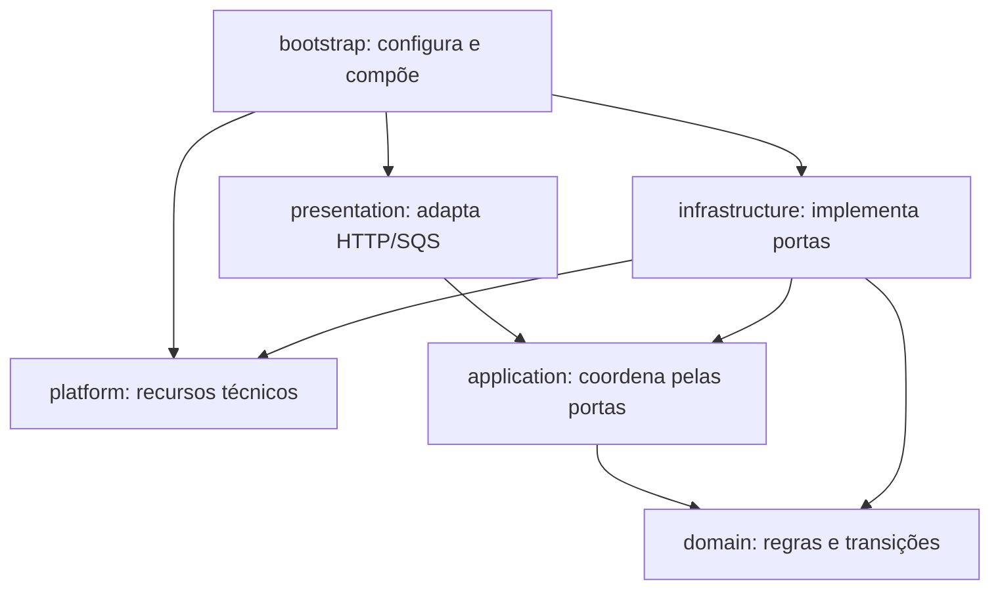

# Módulo financeiro

Este módulo mantém as regras e a consistência de wallet, transação, ledger, inbox
e outbox. API e workers são entradas para os mesmos casos de uso.

| Pasta | Responsabilidade | Pode depender de |
|---|---|---|
| domain/money | Valor monetário, moeda e erros de representação | Domínio e Decimal.js |
| domain/wallet | Wallet, movimento e ledger | Domínio |
| domain/wagering | Tipos, estado e transições das apostas | Domínio |
| domain/validation | Validações puras compartilhadas pelo núcleo | Linguagem |
| application/use-cases | Abertura, processamento, retomada, publicação e DLQ | Aplicação, domínio e portas |
| application/transactions | Comando/hash e coordenação compartilhada de aplicação/persistência | Aplicação, domínio e portas |
| application/queries | Consultas, paginação e reconciliação | Aplicação, domínio e portas |
| application/events | Contratos de integração, envelopes e construção de outbox | Aplicação e domínio |
| application/ports | Contratos exigidos pelos casos de uso | Contratos da aplicação e domínio |
| infrastructure | Implementações concretas de persistência, SQS, cursor, runtime e observabilidade financeira | Infraestrutura, aplicação, domínio e platform |
| presentation/http | Controllers, identidade, erros e status HTTP | Apresentação, aplicação e domínio |
| presentation/sqs | Envelope, handler e lifecycle do consumidor de comandos | Apresentação, aplicação e domínio |

As setas representam dependências de código. Em execução, a aplicação chama uma
porta cuja implementação é injetada no bootstrap.

## Onde acrescentar comportamento

- Uma regra de saldo ou reversão pertence ao domínio; sua coordenação SQL pertence
  à aplicação e ao adaptador de persistência.
- Um endpoint novo fica em presentation/http. O domínio não define códigos HTTP.
- Um novo evento de integração fica em application/events. Seu envio externo fica
  em infrastructure/events; os eventos entram na outbox no commit financeiro.
- SQL que conhece tabelas financeiras pertence a infrastructure, incluindo probes,
  backlog e migrations. O registro dos modelos/migrations fica no bootstrap.
- Um recurso em platform deve funcionar sem importar este módulo. SDK clients e
  lifecycle operacional recebem configuração/contratos, sem conhecer regras financeiras.

## Contratos e compatibilidade

FinancialUnitOfWork mantém uma única transação e oferece FinancialPersistence ao
callback. A separação dos contratos de transação, inbox, outbox e transporte não
cria commits independentes. FinancialPersistence não pode escapar do callback.

Resultados novos armazenam estado, saldo histórico e failureCode. HTTP mapeia esse
estado para 200/202/422/500 na apresentação. stored-wager-result.ts valida e remove
o campo httpStatus de resultados antigos durante a leitura; não reescreve terminais.

O contexto de telemetria é próprio de cada operação/entrega e acompanha os IDs disponíveis
por retry/lock e SQS até ACK, sem variável global. O deadline do processo cobre também
a limpeza dos recursos.

Testes do domínio ficam junto às classes; integração e processos estão em tests.
`bun run check:architecture` verifica imports, ciclos e presença de status HTTP no
núcleo. Esse check também integra `bun run typecheck`. A regra é estática; correção
financeira continua sendo comprovada pelos testes com PostgreSQL e LocalStack.
